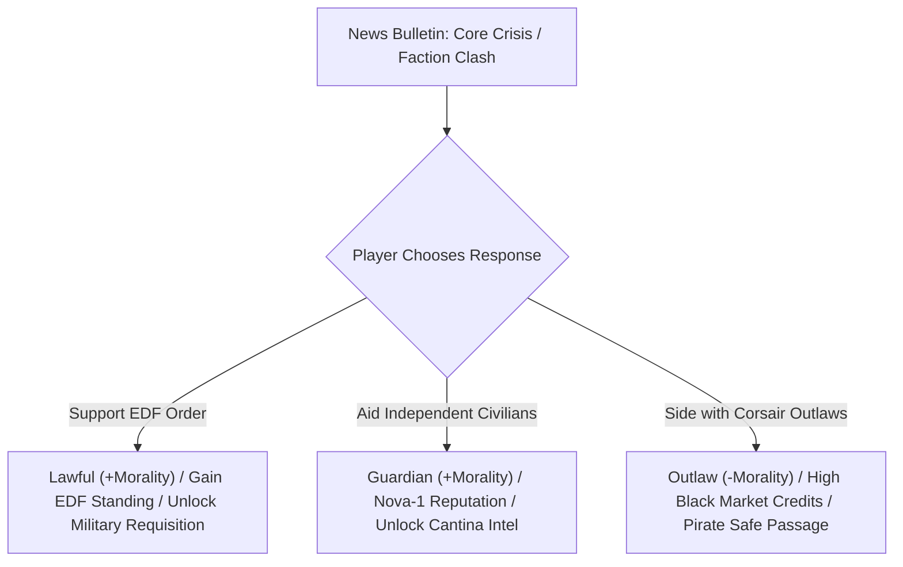

# Nova News — Branching Stories & Faction Drama Guide

This document defines the in-universe news articles and faction drama events that drive the story branches, player morality choices, and dynamic missions in *Project Nova*.

---

## ⚖️ Game Integration: The Morality & Faction System

As documented in `OWNER_FEATURES.md`, the player has a **Morality Meter from −100 (Pirate/Outlaw) to +100 (Lawful/EDF/Guardian)** recorded in their FLIGHT RECORD.

When players read articles on their cockpit News Terminal or hear bulletins over the comms/podcasts, they can interactively choose how to respond to the crisis:

---

## 📰 Story Branch 1: The Helios Gate Embargo

### Article Details
* **ID**: `art_001_helios_embargo`
* **Headline**: EDF ORDERS MANDATORY CORE SURRENDER AT HELIOS GATE
* **Network**: *Nova Net Broadcast Syndicate*
* **Reporter**: Talia Vance
* **Visual Asset**: `art_src/news/article_02_edf_blockade.png`
* **Audio Companion**: `public/news/audio/newsflash_edf_01.mp3`

### Article Copy
> *“HELIOS REACH — Earth Defense Fleet Command has cordoned off the Helios Warp Corridor, boarding all incoming private freighters and impounding class-three thermal containment units. Vice Admiral Sterling cited 'unprecedented solar degradation and extreme military operational necessity' for the seizure.*
> 
> *Independent mining unions have condemned the move, warning that without heat cores, atmospheric scrubbers across peripheral asteroid habitats will freeze solid within seventy-two hours. Corsair raiders have reportedly moved three strike wings into striking distance of the gate.”*

### Interactive Story Choices for Player
1. **Option A: “Honor the Embargo” (EDF Alignment)**
   - *Action*: Voluntarily turn over salvaged cores at the military checkpoint.
   - *Morality Impact*: `+15` (Lawful)
   - *Game Effect*: Gain EDF Patrol escort in Sector 2; receive military torpedo ordinance.
2. **Option B: “Run the Blockade” (Independent / Civilian)**
   - *Action*: Smuggle warmth pods through the sensor shadow to Hab Pod 4.
   - *Morality Impact*: `+10` (Benevolent)
   - *Game Effect*: Nova-1 Cantina prices drop 20%; access to grateful civilian repair technician.
3. **Option C: “Tip off the Corsairs” (Pirate / Outlaw)**
   - *Action*: Transmit the EDF patrol schedule to pirate gunboats for a kickback.
   - *Morality Impact*: `-25` (Pirate)
   - *Game Effect*: Receive 15,000 black market credits; EDF becomes hostile in Helios sector.

---

## 📰 Story Branch 2: Cantina Black Market Auction

### Article Details
* **ID**: `art_002_cantina_auction`
* **Headline**: SUSPECTED MILITARY CORE AUCTIONED IN NOVA-1 CANTINA
* **Network**: *Independent Comms Net*
* **Visual Asset**: `art_src/news/article_05_cantina_standoff.png`
* **Audio Companion**: `public/news/audio/podcast_ep01_deep_cold.mp3`

### Article Copy
> *“STATION NOVA-1 — Tensions flared in the lower cantina concourse last night as an unflagged smuggler attempted to auction a high-yield fusion core with scrubbed serial numbers. Eyewitnesses report drawing of weapons before station security intervened.*
> 
> *The core is believed to originate from the derelict frigate 'Meridian', lost during last month’s solar flare incident. With heating reserves dwindling, bidding was fiercest between corporate refinery representatives and pirate brokers.”*

### Interactive Story Choices for Player
1. **Option A: “Secure for Station Power”**
   - *Action*: Intervene, pay off the smuggler, and donate the core to Nova-1 municipal grid.
   - *Morality Impact*: `+20` (Guardian)
   - *Game Effect*: Cantina patrons cheer; unlocked unique bartender dialogue; permanent station shield boost.
2. **Option B: “Outbid Everyone”**
   - *Action*: Buy the core for your own starfighter upgrades.
   - *Morality Impact*: `0` (Neutral / Pragmatic)
   - *Game Effect*: Ship boost capacitor charges 35% faster.
3. **Option C: “Ambush the Buyer Outside the Dock”**
   - *Action*: Wait until the winning bidder launches, disable them, and seize the core.
   - *Morality Impact*: `-30` (Ruthless Outlaw)
   - *Game Effect*: High salvage loot; Station Nova-1 docking bay turrets remain on caution status.

---

## 📰 Story Branch 3: Awakening of the Automaton Swarms ("Clankers")

### Article Details
* **ID**: `art_003_clanker_awakening`
* **Headline**: DERELICT ALIEN MEGASHIP ACTIVATES IN FORBIDDEN NEBULA
* **Network**: *Deep Orbit Science Dispatch*
* **Visual Asset**: `art_src/news/article_04_alien_awakening.png`
* **Audio Companion**: `public/news/audio/radio_corsair_ep04.mp3`

### Article Copy
> *“THE PERIMETER — Deep range sensor arrays have detected massive energy surges inside the Azure Nebular Veil. Long-dormant automaton ships—pejoratively nicknamed 'Clankers' by system prospectors—have begun radiating coherent emerald-spectrum energy.*
> 
> *Unlike human vessels which consume fusion cores to survive the cold, the automata appear capable of siphoning ambient cosmic radiation directly. Both EDF and pirate factions are scrambling expeditionary fleets to recover or scavenge their alien power technology.”*

### Interactive Story Choices for Player
1. **Option A: “Scientific Reconnaissance”**
   - *Action*: Fly passive scan passes without firing weapons to decode their signal.
   - *Morality Impact*: `+10` (Curious / Peaceful)
   - *Game Effect*: Unlocks alien cipher HUD upgrade; alien drones remain non-hostile unless provoked.
2. **Option B: “Join the Salvage Gold Rush”**
   - *Action*: Target isolated scout drones and salvage their exotic hyper-capacitors.
   - *Morality Impact*: `-10` (Exploitative)
   - *Game Effect*: Rare alien craft components for your ship; drone swarm aggro radius increases.

---

## 📰 Story Branch 4: The Frozen Refugee Convoy

### Article Details
* **ID**: `art_004_refugee_flotilla`
* **Headline**: STRANDED HABITAT FLOTILLA BROADCASTS SOS IN SUB-ZERO VOID
* **Network**: *Public Mayday Relay*
* **Visual Asset**: `art_src/news/article_07_refugee_flotilla.png`
* **Audio Companion**: `public/news/audio/newsflash_nova1_02.mp3`

### Article Copy
> *“OUTER DRIFT — A makeshift flotilla of seven converted mining freighters carrying twelve hundred civilians from the abandoned lunar colony 'Cold Harbor' has experienced total engine failure. Thermal readings show cabin temperatures plummeting toward freezing point.*
> 
> *The convoy is requesting urgent escort and three functioning heat cores to restart their life support systems before life support fails.”*

### Interactive Story Choices for Player
1. **Option A: “Deliver Your Reserve Core”**
   - *Action*: Jump immediately to their beacon and sacrifice one owned heat core.
   - *Morality Impact*: `+35` (Heroic Guardian)
   - *Game Effect*: Refugee pilot joins your recruit pool; public acclaim in all independent stations.
2. **Option B: “Defend Against Pirate Raiders”**
   - *Action*: Provide combat air patrol to repel incoming corsairs while civilian engineers work.
   - *Morality Impact*: `+15` (Defender)
   - *Game Effect*: High combat XP, cash bounty from colonial representatives.
3. **Option C: “Ignore the Beacon”**
   - *Action*: Focus on your own mission objectives.
   - *Morality Impact*: `-15` (Callous)
   - *Game Effect*: Follow-up news article reports convoy loss; derelict hulls appear as salvage later.

---

## 📰 Story Branch 5: The Outer Drift Refugee Flotilla
* **ID**: `talia_05_cold_harbor`
* **Speaker**: Talia Vance
* **Audio**: `public/news/audio/ElevenLabs_audio_elevenlabs-v4_[low, ominous] _2026-11-08T06_58_46.mp3`
* **Morality Choices**:
  1. Guardian [+15]: Transfer reserve heat core to hab.
  2. Neutral [0]: Relay distress coordinates to fleet.
  3. Pirate [-15]: Extort fuel payment before assisting.

---

## 📰 Story Branch 6: Talia Vance Sign-Off
* **ID**: `talia_06_sign_off`
* **Speaker**: Talia Vance
* **Audio**: `public/news/audio/sign_off_vance.mp3`
* **Quote**: *"Watch your vectors, pilots. Every delivery has a destination. Every choice has a cost."*
* **Morality Choices**:
  1. Guardian [+15]: Pledge defense to independent lanes.
  2. Neutral [0]: Maintain neutral mercenary status.
  3. Pirate [-15]: Broadcast defiance on pirate radio.

---

## 📰 Story Branch 7: Ghost Signal & Admiral Voss
* **ID**: `talia_07_admiral_voss`
* **Speaker**: Talia Vance
* **Audio**: `public/news/audio/ElevenLabs_audio_elevenlabs2.mp3`
* **Morality Choices**:
  1. Guardian [+15]: Transmit intel to wingman Valkyrie-7.
  2. Neutral [0]: Keep carrier coordinates encrypted.
  3. Pirate [-15]: Sell flagship coordinates to Corsair syndicates.

---

## 📰 Story Branch 8: Chronos Reckoning & Mind Space
* **ID**: `talia_08_chronos_reckoning`
* **Speaker**: Talia Vance
* **Audio**: `public/news/audio/ElevenLabs_audio_elevenlabs3.mp3`
* **Morality Choices**:
  1. Guardian [+15]: Harmonize cores for sector survival.
  2. Neutral [0]: Secure ship escape route into warp.
  3. Pirate [-15]: Seize prime core conduit for energy supremacy.
